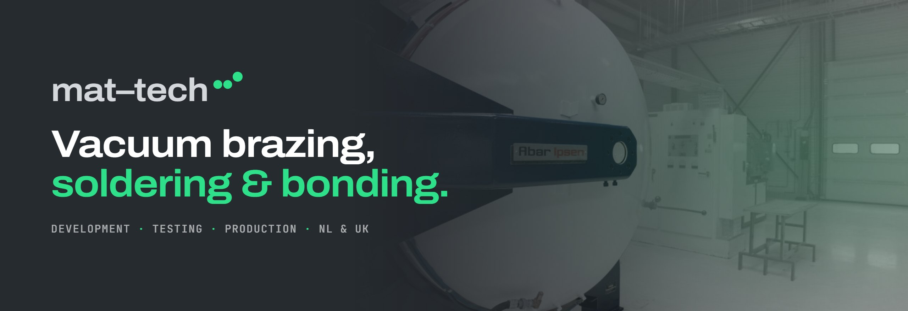
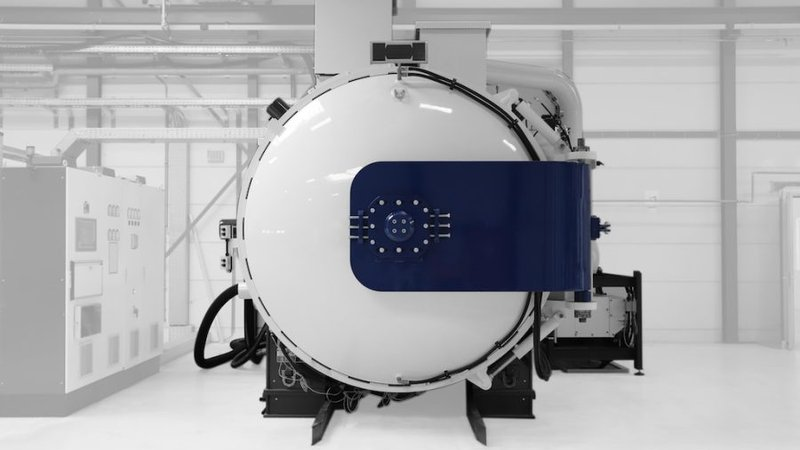
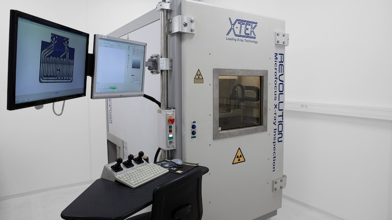
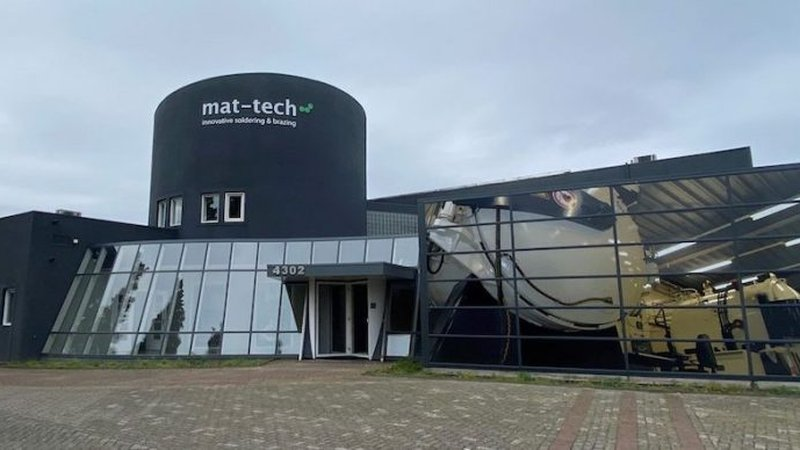

  

# Mat-Tech

**Advanced joining technologies for high-temperature and cryogenic applications.**

Mat-Tech develops, optimises and tests joining solutions, from vacuum brazing and diffusion bonding to fluxless and lead-free soldering, so components cost less to make and last longer in service.

Mat-Tech Development & Testing and Mat-Tech Production operate from the Netherlands and the UK, serving customers across Europe and worldwide, from a single prototype to series production under ISO 9001.

🌐 **[mat-tech.com](https://mat-tech.com)**

## What we do

| Production | Development & Testing |
| --- | --- |
| [Vacuum brazing](https://mat-tech.com/vacuum-brazing/) | [Process and product development](https://mat-tech.com/development/) |
| [Induction brazing](https://mat-tech.com/induction-brazing/) | [Optical microscopy](https://mat-tech.com/optical-microscopy-om/) |
| [Diffusion bonding](https://mat-tech.com/diffusion-bonding/) | [SEM with EDX](https://mat-tech.com/scanning-electron-microscope-sem/) |
| [Metal–ceramics brazing](https://mat-tech.com/metal-ceramics-brazing/) | [Coordinate-measuring machine (CMM)](https://mat-tech.com/coordinate-measuring-machine-cmm/) |
| [Aluminium brazing](https://mat-tech.com/aluminium-brazing/) | [3D X-ray visualisation](https://mat-tech.com/3d-x-ray-visualisation/) |
| [Fluxless soldering](https://mat-tech.com/fluxless-soldering/) | [Research options](https://mat-tech.com/research-options/) |

Published research on brazing, bonding and soldering is in our [Knowledge Centre](https://mat-tech.com/knowledge-centre/).

## Inside Mat-Tech

<table>
  <tr>
    <td width="50%"> Vacuum brazing furnace</td>
    <td width="50%"> Optical microscopy</td>
  </tr>
  <tr>
    <td width="50%"> 3D X-ray inspection</td>
    <td width="50%"> Our facility in Son, the Netherlands</td>
  </tr>
</table>

## Locations

| Netherlands | United Kingdom |
| --- | --- |
| **Mat-Tech B.V.** Ekkersrijt 4302 5692 DH Son +31 (0)499 490133 | **Mat-Tech Joining Technologies Ltd** A2, Douglas Park, Opal Way Stone Business Park, Stone Staffordshire ST15 0YJ +44 (0)1785 847 547 |

Questions about a joining application, or looking for a manufacturing partner? **[Contact us](https://mat-tech.com/contact/)**.

  <a href="https://mat-tech.com">
    <picture>
      <source media="(prefers-color-scheme: dark)" srcset="assets/logo-dark.png">
      
    </picture>
  </a>

